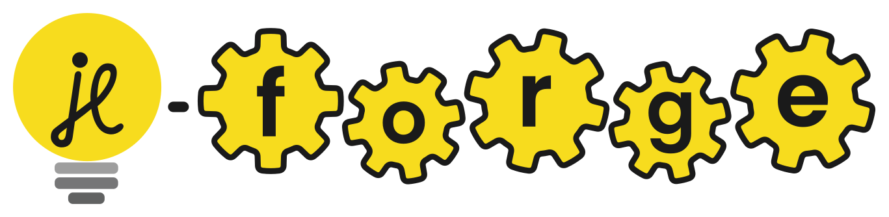

[![Tests][tests-badge]][tests-url]
[![Build demo][ci-badge]][ci-url]
[![Coverage][codecov-badge]][codecov-url]
[![xeus-badge][xeus-badge]][xeus-url]
[![pyodide-badge][pyodide-badge]][pyodide-url]
[![voici-badge][voici-badge]][voici-url]

Package version: `0.8.0`

**Build steps for JupyterLite sites** — turn a Python project and its notebooks into version-matched, pruned and fully offline xeus-python or Pyodide sites, sized for GitHub or GitLab Pages.

## Try it

[`examples/demo`](https://github.com/decitre/jl-forge/tree/main/examples/demo) builds one notebook into both sites, deployed to GitHub Pages by CI. They load nothing from other hosts.

- **[xeus-python site][xeus-url]**, **[Pyodide site][pyodide-url]**
- **Voici dashboards**: [xeus-python](https://decitre.github.io/jl-forge/xeus/voici/render/demo.html), [Pyodide](https://decitre.github.io/jl-forge/pyodide/voici/render/demo.html)

## Requirements

- Python >= 3.11 on the build machine (macOS or Linux); jl-forge installs nothing in the browser
- `jupyterlite-core` and a kernel package, in the same environment as jl-forge (not `pipx` or `uv tool`)
- [micromamba](https://mamba.readthedocs.io/en/latest/installation/micromamba-installation.html), for xeus-python sites

## Install

```sh
pip install 'jl-forge[xeus]' jupyterlite-core                                  # xeus-python site
pip install 'jl-forge[pyodide]' jupyterlite-core jupyterlite-pyodide-kernel    # Pyodide site
```

## Usage

`jupyter lite build` builds the site; jl-forge does what surrounds it, from your build script: dependencies from `pyproject.toml`, Pyodide pruned from 340 MB to 23 MB, xeus environments packed and cached, no request to other hosts, and a size check for Pages limits. It doesn't replace `jupyter lite build`; [when to use jl-forge](https://github.com/decitre/jl-forge/blob/main/docs/SCOPE.md) says when you can do without it.

The [Usage Guide](https://github.com/decitre/jl-forge/blob/main/docs/USAGE.md) has each command and a complete script for both kernels; the demo's [`build.sh`](https://github.com/decitre/jl-forge/blob/main/examples/demo/build.sh) is the smallest real one to adapt.

## Compatibility

| Site | Kernel | Apps | Python |
|:--|:--|:--|:--|
| xeus-python | `jupyterlite-xeus` 5.x | Lab, Notebook, Voici | 3.13 |
| Pyodide | `jupyterlite-pyodide-kernel==0.7.0` | Lab, Notebook, Voici | 3.13 |
| Pyodide | `jupyterlite-pyodide-kernel` 0.8.x | Lab, Notebook | 3.14 |

Each is built and smoke-tested in CI. [Why these versions](https://github.com/decitre/jl-forge/blob/main/docs/COMPATIBILITY.md), and how [Voici](https://github.com/decitre/jl-forge/blob/main/docs/VOICI.md) fits.

## How It Works

```
┌───────────────────────────────────────────┐
│ pyproject.toml          notebooks/*.ipynb │
└──────┬──────────────────────────┬─────────┘
       │ jl-forge                 │ jl-forge notebooks
┌──────▼────────────────┐ ┌───────▼──────────────────┐
│ xeus-env / xeus-mount │ │ pyodide-install          │
│ conda prefix (wasm)   │ │ wheel + install.py       │
└──────┬────────────────┘ └───────┬──────────────────┘
       │ jupyter lite build       │ jupyter lite build
┌──────▼────────────────┐ ┌───────▼──────────────────┐
│ public/xeus/          │ │ public/pyodide/          │
└───────────────────────┘ └──────────────────────────┘
               static site → GitHub Pages
```

## Documentation

- **[Usage Guide](https://github.com/decitre/jl-forge/blob/main/docs/USAGE.md)** - CLI reference, Python API, compatibility guarantees, complete build script
- **[When to Use jl-forge](https://github.com/decitre/jl-forge/blob/main/docs/SCOPE.md)** - What JupyterLite provides, what jl-forge adds, related projects
- **[Voici Dashboards](https://github.com/decitre/jl-forge/blob/main/docs/VOICI.md)** - Set up, constraints and known problems
- **[Apps, Kernels & Version Constraints](https://github.com/decitre/jl-forge/blob/main/docs/COMPATIBILITY.md)** - Lab, Notebook and Voici on xeus-python and Pyodide
- **[Runtime & Integration](https://github.com/decitre/jl-forge/blob/main/docs/RUNTIME.md)** - What runs where
- **[Development](https://github.com/decitre/jl-forge/blob/main/docs/DEVELOPMENT.md)** - Setup, tests, release, feedback and AI-assisted contributions

## Contributing

jl-forge is an early-stage project; issues and pull requests are welcome. [DEVELOPMENT.md](https://github.com/decitre/jl-forge/blob/main/docs/DEVELOPMENT.md) covers the setup, tests and AI-assisted contributions.

## License and Citation

Apache License 2.0. See [LICENSE](https://github.com/decitre/jl-forge/blob/main/LICENSE) and [NOTICE](https://github.com/decitre/jl-forge/blob/main/NOTICE).

```bibtex
@software{jlforge2026,
  author = {Decitre, Emmanuel},
  title = {jl-forge: Build tooling for JupyterLite sites},
  year = {2026},
  url = {https://github.com/decitre/jl-forge}
}
```

Built on [JupyterLite](https://jupyterlite.readthedocs.io/), [xeus-python](https://github.com/jupyter-xeus/xeus-python), [jupyterlite-xeus](https://github.com/jupyterlite/xeus), [emscripten-forge](https://emscripten-forge.org/), [Pyodide](https://pyodide.org/) and [jupyterlite-pyodide-kernel](https://github.com/jupyterlite/pyodide-kernel).

[tests-badge]: https://github.com/decitre/jl-forge/actions/workflows/test.yml/badge.svg
[tests-url]: https://github.com/decitre/jl-forge/actions/workflows/test.yml
[codecov-badge]: https://img.shields.io/codecov/c/github/decitre/jl-forge/main?flag=python&label=Coverage&logo=codecov
[codecov-url]: https://codecov.io/gh/decitre/jl-forge
[ci-badge]: https://github.com/decitre/jl-forge/actions/workflows/build.yml/badge.svg
[ci-url]: https://github.com/decitre/jl-forge/actions/workflows/build.yml
[pyodide-badge]: https://img.shields.io/badge/try-Pyodide-f7dc1e.svg?logo=
[xeus-badge]: https://img.shields.io/badge/try-xeus--python-f7dc1e.svg?logo=
[voici-badge]: https://img.shields.io/badge/try-Voici-f7dc1e.svg
[voici-url]: https://decitre.github.io/jl-forge/xeus/voici/render/demo.html
[xeus-url]: https://decitre.github.io/jl-forge/xeus/lab/index.html?path=demo.ipynb
[pyodide-url]: https://decitre.github.io/jl-forge/pyodide/lab/index.html?path=demo.ipynb
